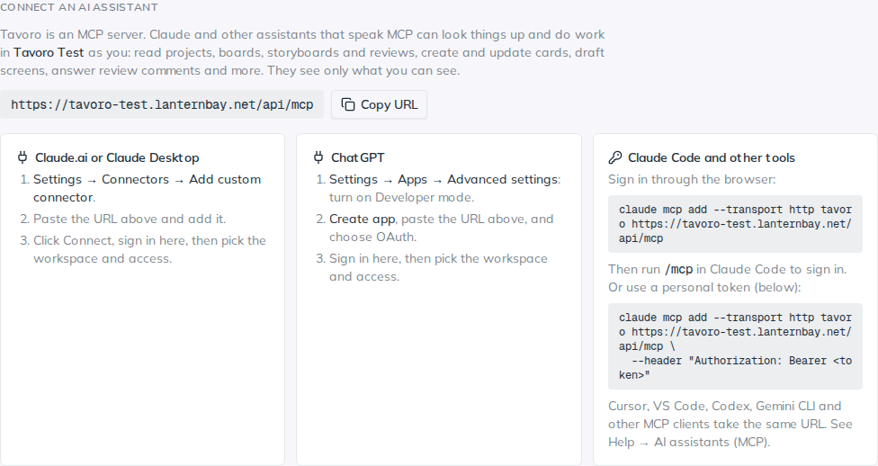

<!-- Generated from src/components/help by `npm run help:export`. Edit the app's help, not this file. -->

# AI assistants (MCP)

> Tavoro is an **MCP server**. MCP (Model Context Protocol) is how AI assistants such as Claude, ChatGPT and Cursor connect to the tools you use. Once connected, you can ask your assistant to look things up and do the work in your workspace: “What’s waiting on me?”, “Turn Dana’s review comments into cards”, “Draft three screens on phishing for the Module 1 storyboard.”

## Connect Claude.ai or Claude Desktop

*Settings → AI & MCP: the server URL and how to connect each assistant.*

1. In Tavoro, open **Settings → AI & MCP** and copy the server URL. It ends in `/api/mcp`.
2. In Claude, open **Settings → Connectors**, choose **Add custom connector**, and paste the URL.
3. Click **Connect**. You’re sent to Tavoro to sign in. Pick the **workspace** Claude may use and the **access** (read and change, or read only), then **Allow**.

## Connect ChatGPT

1. In ChatGPT, open **Settings → Apps → Advanced settings** and turn on **Developer mode** (your plan and workspace admin decide whether it’s available).
2. Choose **Create app**, paste the Tavoro URL, and set authentication to **OAuth**.
3. ChatGPT sends you to Tavoro to sign in. Pick the workspace and access, then **Allow**.

In a chat, pick the Tavoro app from the tools menu. Deep research can also read from Tavoro: it uses the `search` and `fetch` tools, which return whole cards, projects, storyboards and review rounds as documents.

## Connect Claude Code or another tool

In Claude Code, add the server and sign in through the browser with `/mcp`:

claude mcp add --transport http tavoro https://your-tavoro/api/mcp

Tools that can’t sign in through a browser use a **personal token** instead: **Settings → AI & MCP → New token**, then send it as `Authorization: Bearer tav_…`. The token is shown once; store it like a password.

**Cursor** — `.cursor/mcp.json`: `{"mcpServers": {"tavoro": {"url": "https://your-tavoro/api/mcp"}}}`. Cursor signs in on first use.

**VS Code (Copilot)** — `.vscode/mcp.json`: `{"servers": {"tavoro": {"type": "http", "url": "https://your-tavoro/api/mcp"}}}`.

**Codex** — `~/.codex/config.toml`: a `[mcp_servers.tavoro]` table with `url = "https://your-tavoro/api/mcp"`, then `codex mcp login tavoro`. Or set `bearer_token_env_var` to a variable holding a personal token.

**Gemini CLI** — `~/.gemini/settings.json`: `{"mcpServers": {"tavoro": {"httpUrl": "https://your-tavoro/api/mcp"}}}`, then `/mcp auth tavoro`.

## What an assistant can do

**Find and read** — Search; your workspace’s members, labels, statuses and sprints; My Work; boards and cards (by key such as SEC-12); projects with phases, deliverables, milestones and objectives; storyboards screen by screen; review rounds with every comment; all feedback on a deliverable; intake requests; sprints.

**Plan and track** — Create boards, columns and cards; update cards (description, due date, column, assignees, SMEs, labels, sprint); comment; add and tick subtasks; create projects, phases, deliverables, milestones, objectives and assessment items; log time; create and run sprints; triage intake (admins).

**Design** — Create storyboards, add and edit screens (on-screen text, narration, visuals, interaction, developer notes) and link them to objectives.

**Review** — Start review rounds, comment on a screen or a PDF page, resolve or won’t-fix threads, record your own decision, and send comments to a board as cards.

Text goes in and out as Markdown. Connected assistants also get ready-made **prompts**: a project status report, summarizing review feedback, drafting storyboard screens, triaging intake, and planning a sprint.

## Access and safety

- An assistant acts **as you**, in **one workspace**, and sees only what you can see. Everything it does appears under your name, and the usual emails go out (to assignees, reviewers and so on).
- A read-only connection doesn’t even see the tools that change things. Deleting is marked as destructive, so assistants ask before doing it.
- **Settings → AI & MCP** lists your connections with when each was last used. Disconnect or revoke one and it stops at once. Admins can see and disconnect everyone’s.
- Connected apps renew their access every hour, and stop after 30 days without use. Personal tokens expire when you chose.
- If your identity provider deactivates you (see Single sign-on), every token and connection you made stops working at once.

> **Tip.** Start a conversation with something like “Use Tavoro: what’s waiting on me this week?” The assistant learns your workspace from there.

### Not included

Uploading files (attachments, PDFs for review), whiteboards, workspace settings, members and backups stay in the app.

---

← [Notifications & email](notifications.md) · [All guides](README.md) · [Single sign-on & provisioning](sso.md) →
