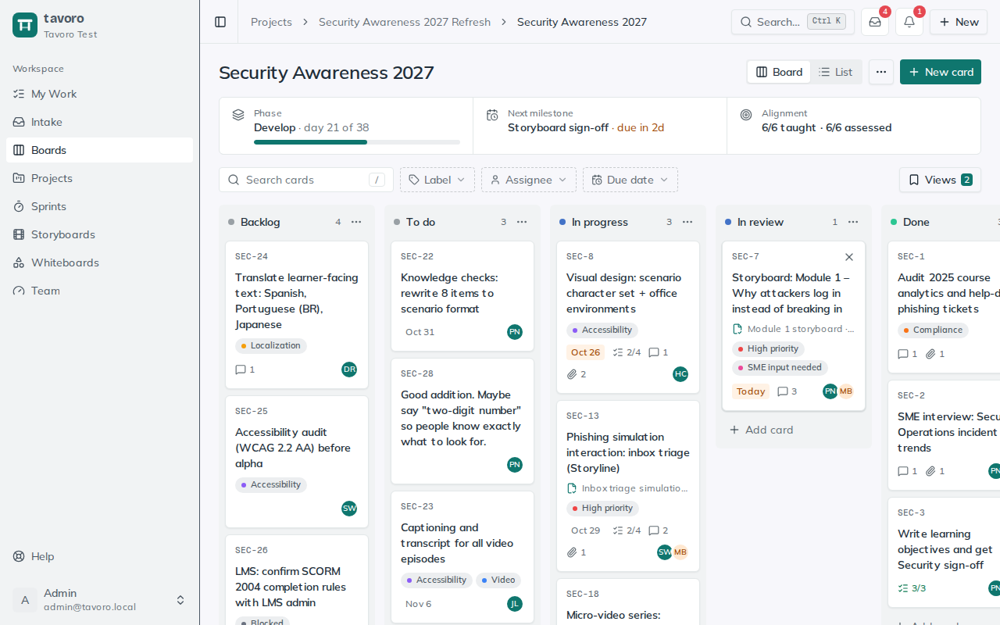
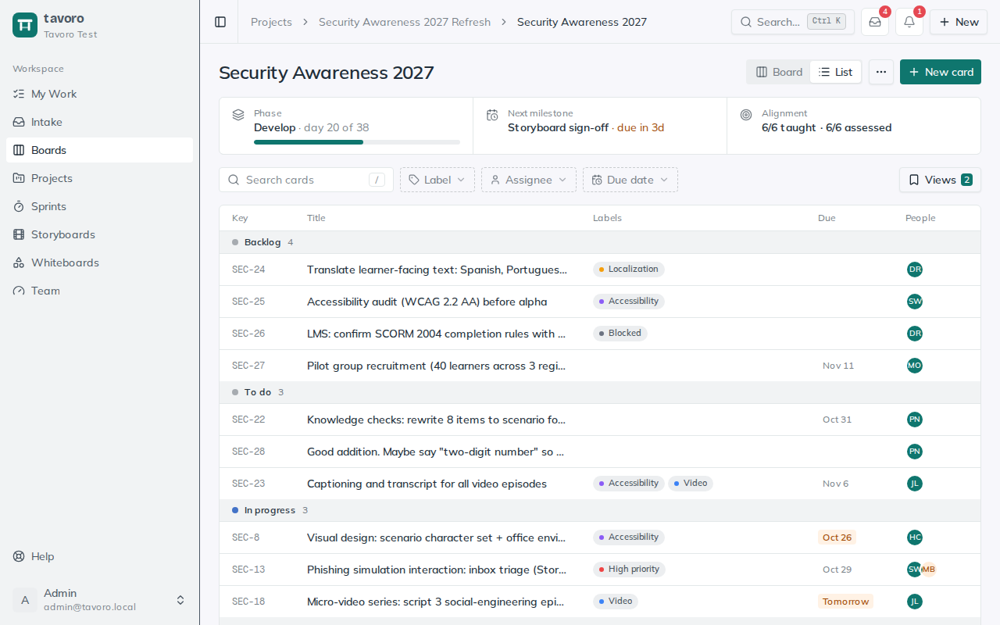
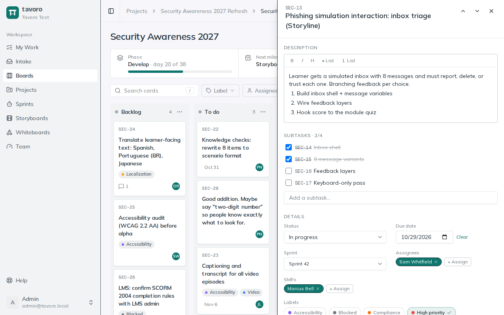

<!-- Generated from src/components/help by `npm run help:export`. Edit the app's help, not this file. -->

# Boards (Kanban)

> A **board** is a Kanban view of your production pipeline — columns you move cards across as work progresses. Each card holds the real detail: a rich-text description, due date, labels, assignees and SMEs, subtasks, comments, attachments, linked whiteboards, and any review feedback sent to it. It’s where the day-to-day “what’s in flight and who has it” lives.

## Create a board and shape its columns

Boards live under **Boards** in the sidebar. A board can stand on its own or belong to a project (create it from the project’s **Boards** section). A new board starts with three columns — *To do*, *In progress*, *Done* — that you reshape to match how your team works.

1. Choose **New board** on the **Boards** page (or **New → Board** in the header from anywhere), type a name in **Board name…**, and choose **Create**. The new board opens straight away.
2. Add a stage with the **+** at the right end of the columns: name it in **Column name…** and choose **Add column**.
3. Rename a column by clicking its title. Its **⋯** menu has **Move left**, **Move right**, and **Delete column…** (which deletes the column and its cards).
4. Rename the board by clicking its title. The **⋯** (**Board settings**) menu beside the view switch sets the **Card prefix**, shares the board publicly (see *Sharing a board publicly* below), and holds **Delete board…**, which permanently deletes every column and card on it.

### Card keys

Give a board a **Card prefix** (for example `SEC`) and every card gets a short key like `SEC-12`, shown on the card and in the drawer. Keys make cards easy to mention in conversation and to refer to from AI assistants. Each board in a workspace needs its own prefix. Changing it re-labels the board’s cards; the numbers stay the same.

## Cards

*A project board: the project strip, the filter bar, and the columns.*

Add a card with **Add card** at the bottom of a column, or **New card** in the board header, then type a title in **Card title…**. To move a card, drag it: within a column to reorder, or across columns to change its stage. Dragging works with filters on, too — a dropped card lands next to the card you can see. Positions save automatically.

The card face shows its state at a glance: key, labels, a due-date chip (red when overdue), a subtask count (green once every subtask is done), comment and attachment counts, and the assignees. Click a card to open its drawer.

### Board and list views

*List view: the same cards as a table, grouped by column.*

The **Board** / **List** switch in the header changes how the same cards are shown: columns you drag between, or a table grouped by column with key, title, labels, people, and due date. Filters apply to both.

## The card drawer, in depth

*The card drawer for SEC-13, with its subtasks and details.*

Opening a card slides in a drawer with everything about it. Changes save as you go — there’s no save button. Press **Esc** or use **Close card** to close it; **J** and **K** step to the next and previous card, and **Copy shareable link** copies a link that opens this card for anyone who can see the board.

**Title** — Edit it at the top of the drawer; the card face updates when you click away.

**Description** — Rich text with bold, italic, a heading, and bulleted or numbered lists. Type **@** to mention a teammate who can see the card — they get an email with a link straight back to it.

**Subtasks** — Break the card down with **Add a subtask…**. Each subtask is a small card of its own: tick it done, give it an assignee, or open it. The section header shows *done / total*, mirrored on the card face. Subtasks assigned to you show in My Work.

**Review feedback** — When review comments are sent to a board as cards (from a review round or a deliverable’s feedback view), the card lists them here with where they were left, so the fix and the comment stay together.

**Status** — The column the card is in. Changing it here moves the card. Each column maps to one of the workspace’s statuses (to do, in progress, done and so on), which drive the sprint board and cross-board views; a status change notifies the card’s assignees and SMEs.

**Visibility** — **Private** leaves the card off the board’s public link, if it has one. A private card shows a **Private** tag on the board; members still see it as usual. Subtasks follow their card.

**Due date** — Pick a date, or **Clear** it. Due dates drive the due-date filter, the overdue chip, and reminder emails.

**Sprint** — On boards in a sprint-enabled project, assign the card to a **Sprint** to put it on that sprint’s board (**No sprint** takes it off). See the Sprints guide.

**Labels** — Toggle any of the workspace’s labels. Create one by typing in **New label…**, picking a color, and choosing **Add**. Labels are shared across the workspace; admins rename, recolor, and delete them in **Settings → Labels**.

**Assignees and SMEs** — **+ Assign** adds workspace members as assignees (who’s doing it) or SMEs (who checks it for accuracy). Both are emailed when added and notified of comments, and assigned cards show in each person’s My Work.

**Attachments** — Upload files up to 25 MB each, then **Download** or remove them.

**Whiteboards** — **+ New whiteboard** creates an Excalidraw canvas linked to this card, and lists any already linked — handy for wireframing a flow in context.

**Comments** — A rich-text discussion thread. Type **@** to mention someone (they’re emailed); the card’s assignees and SMEs are notified of new comments. You can delete your own comments, and admins can delete any.

To remove a card, use **Delete card** at the bottom of the drawer, or the **×** that appears when you hover over a card on the board.

## Filtering the board

The filter bar above the columns narrows what’s visible without changing anything. Filters stack, so you can answer questions like “overdue cards assigned to me with the *Compliance* label”. While any filter is on, the bar shows *N of M cards*; **Clear** resets them all.

- **Search** — type in **Search cards** to match card titles. (To jump to a card by its key, use the header’s **Search**.)
- **Label** and **Assignee** — open each and check the ones to filter by; the button shows what’s selected.
- **Due date** — **Any due date**, **Overdue**, **Due this week**, or **No due date**.

### Saved views

Once you’ve set up a combination of filters you keep coming back to, open **Views** and choose **Save current filters…** to name it. Pick it from that menu any time to re-apply the whole combination; **Clear view** goes back to everything. Saved views are **yours**, not shared with the workspace, and a board’s views stay with that board. Saving over a name you’ve already used updates that view, and changing a filter by hand detaches the view so the menu never names one while showing something else. The team sprint board has its own **Views** menu that works the same way.

## Sharing a board publicly

A public link lets people outside the workspace (a stakeholder, a client, the rest of the company) follow a board without an account. They see it read-only: they can’t change anything, and the link never leads anywhere else in Tavoro.

1. Open the board’s **⋯** (**Board settings**) menu and choose **Share publicly…**, then **Create public link**.
2. **Copy** the link and send it. While it’s on, the board header shows **Public link on**; click it to come back to these settings.
3. Mark any card that shouldn’t be seen **Private**, in its drawer under **Visibility**.

**What visitors see** — The columns, and each card that isn’t private: its key, title, labels, due date, subtask progress, and description (mentions show as plain names). Click a card to read its description. The page shows the board as it is now, so a refresh picks up changes.

**What they never see** — Private cards, comments, attachments, subtask titles, SMEs, review feedback, whiteboards, and email addresses. Assignees only when you tick **Show who’s assigned**, and then by name only.

**Reset link and Stop sharing** — **Reset link…** makes a new link and stops the old one working, for when it went somewhere it shouldn’t. **Stop sharing** turns the link off; a stopped or reset link shows a not-found page.

> **Heads up.** Anyone who has the link can open it, and can pass it on. Treat it like the board is public, and mark cards private before sharing, not after.

Anyone who can work on a board can share it, from the browser only (an AI assistant connected over MCP can mark cards private but can’t publish a board). Admins see every shared board in **Settings → Sharing**, can turn any link off there, and can switch public links off for the whole workspace.

### How boards fit the pipeline

Boards are the execution layer beneath your projects. A project’s board shows a strip with the project’s current phase, next milestone, and objective alignment above the columns, and a deliverable can link to a specific card, so the planning view and the doing view point at the same work. Use projects to plan the *what* and *when*; use boards to run the day-to-day.

> **Note.** By default every workspace member can see a board. An admin can restrict it to specific groups in **Settings → Groups** — once restricted, only members of those groups (plus admins and managers) can find or open it, anywhere in the app.

---

← [Objectives & alignment](objectives-alignment.md) · [All guides](README.md) · [Projects](projects.md) →
