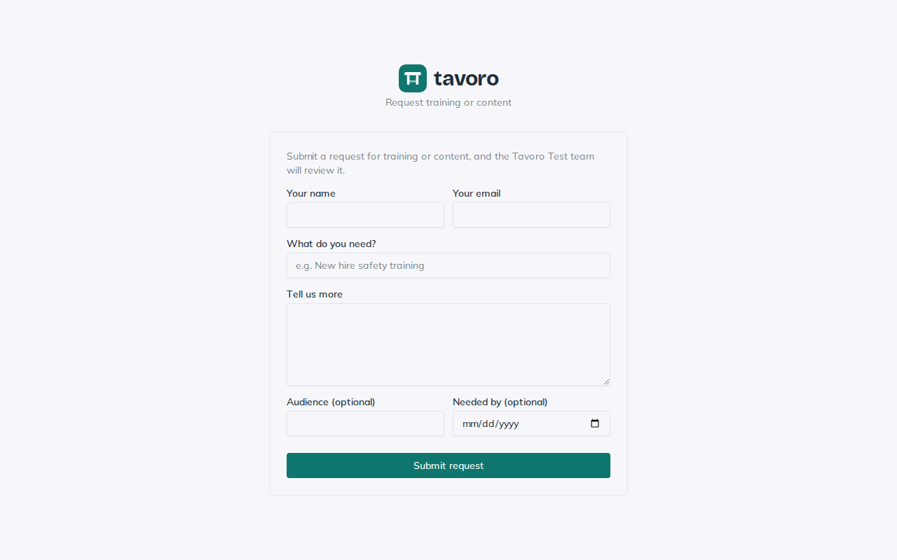
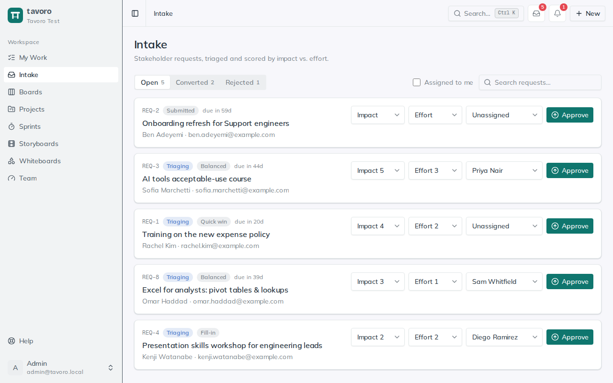
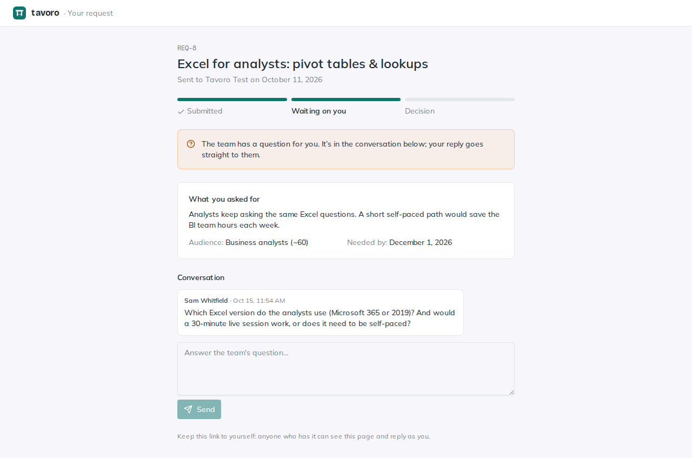
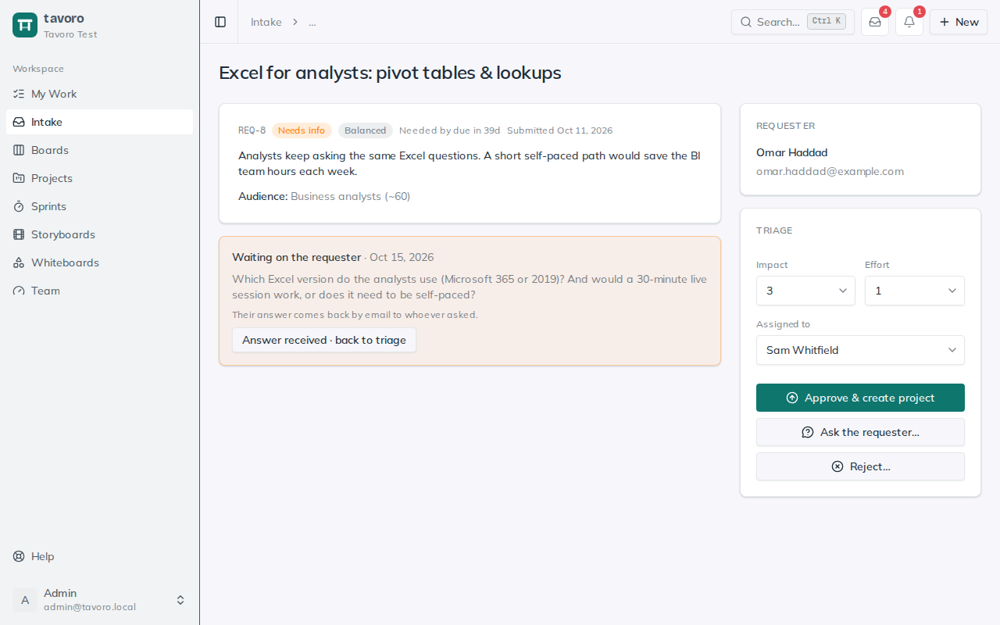
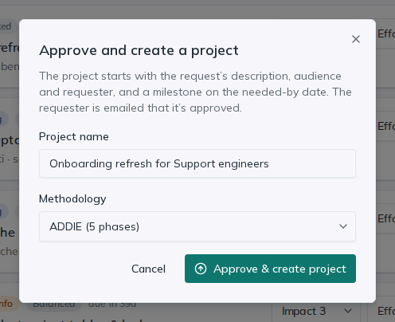

<!-- Generated from src/components/help by `npm run help:export`. Edit the app's help, not this file. -->

# Intake

> **Intake** is the front door for training and content requests. Instead of L&D catching asks over email, chat, and hallway conversations, every request comes in one way, gets triaged and scored, and either becomes a project or a documented no — so your team leads the work rather than reacting to whoever shouted loudest.

## The public intake link

*The public request form. No sign-in needed.*

Every workspace has a public submission form at its own link — something like **/request/your-workspace**. Anyone with the link can submit a request; there’s **no login required**, which is the point — stakeholders shouldn’t need an account to ask for help. Requests they submit land in **Intake** for your team to triage.

1. As a workspace admin, open **Settings → Intake**. You’ll see the **Public intake link** panel with your shareable URL.
2. Click **Copy** to grab the link, then share it however stakeholders reach you — an email signature, a team wiki, an internal portal, a Slack channel topic.
3. To change the address (say, after renaming the workspace), choose **Edit**, type the new ending (lowercase letters, numbers and hyphens), and **Save link**. The old address keeps working and forwards to the new one, so links you’ve already shared don’t break.
4. Use **Enable intake form** / **Disable intake form** to control whether the form accepts requests. While disabled, the link shows a not-found page, so you can pause intake without breaking anything you’ve already shared.

On the form, the requester fills in **Your name** and **Your email**, **What do you need?** (a short title), and **Tell us more** (the full description). Two optional fields help you triage: **Audience** and **Needed by**. On submit they get a confirmation screen with a reference number like **REQ-14**.

> **Spam protection.** The form has a hidden honeypot field that real people never see — if it’s filled in, the submission is silently dropped. Each network can also submit only five requests an hour, so a bot (or an over-eager tab) can’t flood your queue.

## The triage queue

*The triage queue: open requests, unscored first, then by priority.*

Everything that comes in appears on the **Intake** page in the sidebar. Three tabs split the queue: **Open** (submitted, triaging, or waiting on the requester), **Converted**, and **Rejected**, each with its count. On the Open tab the work that needs attention floats up: untriaged requests first, then everything you’ve scored, ordered by priority — highest first. The other two tabs list the most recent decisions first.

Each row shows the reference number, current status, an impact/effort quadrant once scored, and the **Needed by** date (highlighted when it’s close or past). **Search requests…** matches the title, the requester’s name, or a reference like **REQ-14**, and **Assigned to me** narrows the list to yours. Click a title to open the request’s page: the whole description, the audience, the requester, and every action.

The **Intake** button in the header shows a count: for admins and managers, the requests waiting to be triaged; for everyone else, the open requests assigned to them.

### Who can do what

Every member can see the queue and every request. Deciding is for admins and managers, and the person a request is assigned to can do the groundwork on it.

|  | Admins & managers | Assigned member | Other members |
| --- | --- | --- | --- |
| See requests | Yes | Yes | Yes |
| See the requester’s email | Yes | No | No |
| Score impact and effort | Yes | Yes | No |
| Talk to the requester, add notes | Yes | Yes | No |
| Copy or reset the status page link | Yes | Yes | No |
| Assign | Yes | No | No |
| Approve, reject, reopen | Yes | No | No |

## Scoring and assigning

Triage is two quick decisions per request: how much it matters and what it’ll take. You can do both right on the queue row, or on the detail page.

**Impact** — Rate the value of doing this work from **1 to 5**. Higher means it moves the needle more — more learners reached, bigger risk retired, clearer business outcome.

**Effort** — Rate the cost to deliver it from **1 to 5**. Higher means more work — more content to build, more stakeholders to wrangle, more unknowns.

**Assigned to** — Hand the request to a workspace member with the **Assign to** dropdown, or leave it **Unassigned**. Assigning gives it an owner while it’s still just a request: they’re emailed a link (unless they assigned it to themselves, or **Assignments** emails are off in **Settings → Notifications**), it shows under **My intake requests** in their My Work, and they can score it and ask the requester questions.

The moment a request has both scores, Tavoro derives its priority and an impact/effort *quadrant* badge — a *Quick win* (high impact, low effort), a *Big bet* (high impact, high effort), a *Fill-in*, or a *Reconsider* — so you can see at a glance what deserves your team’s time. Scoring an untriaged request also moves it from **Submitted** to **Triaging** automatically.

> **Tip.** You don’t have to score everything before doing anything. The queue keeps unscored requests up top precisely so triage is the fast first pass — skim, score, and let the priority order tell you what to open next.

## The request lifecycle

A request moves through a small, honest set of statuses. Every one is visible on the request, so nobody has to wonder where their ask went.

**Submitted** — Fresh in from the public form and not yet touched. These sit at the top of the queue.

**Triaging** — You’ve started scoring it. A working state — it has an impact and effort read but no final decision.

**Needs info** — Someone asked the requester a question and is waiting for the answer. It stays on the Open tab but out of the header count, since the next move is the requester’s.

**Converted** — Approved and turned into a real project. The request links straight to it.

**Rejected** — Declined, with a reason captured for the record and for the requester. An admin or manager can reopen it.

## The requester’s status page

*What the requester sees: progress, their request, and the conversation.*

Every request has its own private page for the person who sent it. The link is on the “thanks” screen after they submit, in their confirmation email, and in every email you send them. No account is needed: the link itself is the key, so it’s long and unguessable.

**What they see** — Their request as they sent it, where it stands (*Submitted*, *Under review* or *Waiting on you*, then *Approved* or *Not going ahead* with your reason), and the conversation.

**What they never see** — Internal notes, scores, who it’s assigned to, or the project it became.

**Replying** — They can reply on the page at any time. Their reply appears in the request’s conversation, and the person it’s assigned to (or, if nobody, the workspace’s admins and managers) gets an email. If the request was waiting on them, it goes back to triage by itself.

Admins, managers and the assigned member see **Copy link**, **View as requester** and **Reset…** under the requester’s name. Reset makes a new link and stops the old one, for when a link has been forwarded somewhere it shouldn’t be; send the new one to the requester yourself.

## Talking to the requester

*The conversation on a request: replies, and an internal note.*

Requests often arrive thin: no audience, no sense of what success looks like. Rather than guess, ask. The **Conversation** on the request’s page holds two kinds of message:

**Send to requester** — Emailed to the requester and shown on their status page. The email’s reply address is yours, so an answer by email reaches you rather than a no-reply inbox.

**Add internal note** — For the team only: context, a phone call’s outcome, a pasted email answer. Notes show with a lock and a dashed border, and never reach the requester.

Tick **It’s a question** before sending to mark the request **Needs info**. It waits there until the requester replies on their page, which puts it back in triage. If they answer by email or phone instead, add their answer as a note and choose **Back to triage without an answer**.

## Approving and rejecting

*Approving: name the project and pick its methodology.*

When a request is worth doing, use **Approve & create project** on its page (or **Approve** on the queue row). Name the project (it starts as the request’s title) and pick a methodology: **ADDIE**, **SAM**, or **Custom** with no phases yet. The new project starts with what the requester told you:

**Description** — The request’s description, its audience and needed-by date, and who asked (for example *Requested by Dana Lee (REQ-14)*). Edit it freely afterwards.

**Milestone** — When the request had a needed-by date, a milestone on that date called *Needed by <requester>*.

**Link back** — A **From REQ-14** tag beside the methodology on the project, which opens the request.

The request becomes **Converted**, records who approved it and when, and you land on the new project to start planning.

When a request isn’t a fit, choose **Reject…**, add a short reason (optional, but kind; it’s emailed to the requester), and **Confirm reject**. The request records the reason, who rejected it and when. If it was a mistake, or things change, an admin or manager can **Reopen** it: it goes back to the queue without emailing the requester, who hears again when it’s decided. A converted request can’t be reopened; its project carries the work.

> **Emails go out automatically.** The requester always gets a confirmation email the moment they submit, a decision email when you approve or reject, and every reply you send them, each with a link to their status page — those are transactional and can’t be switched off. Workspace admins can also get a heads-up email on each new request; that one respects the **Intake** toggle in **Settings → Notifications**. See the Notifications article for the full picture.

### How Intake fits

Intake is the top of the funnel: it’s where demand enters, gets weighed, and turns into committed work. Approved requests flow directly into *Projects*, where their methodology carries them from analysis through evaluation. Think of Intake as deciding *whether* and *what*, and Projects as running the *how*.

---

← [Whiteboards](whiteboards.md) · [All guides](README.md) · [My Work & reviews](my-work.md) →
