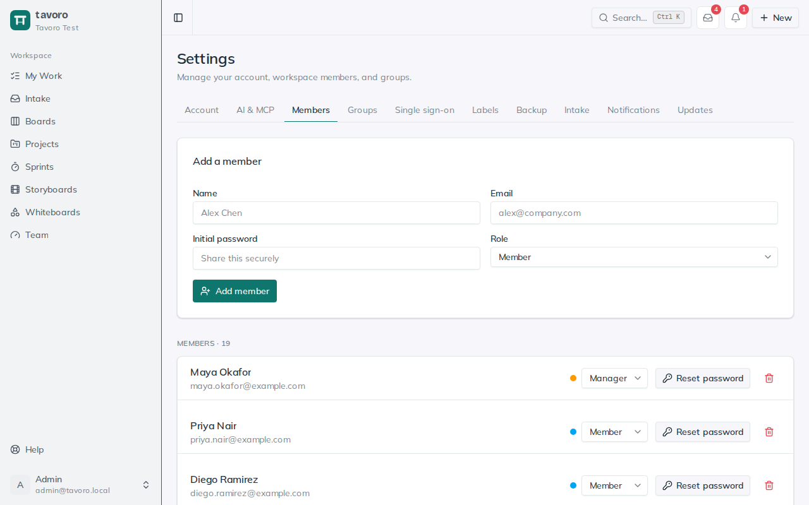
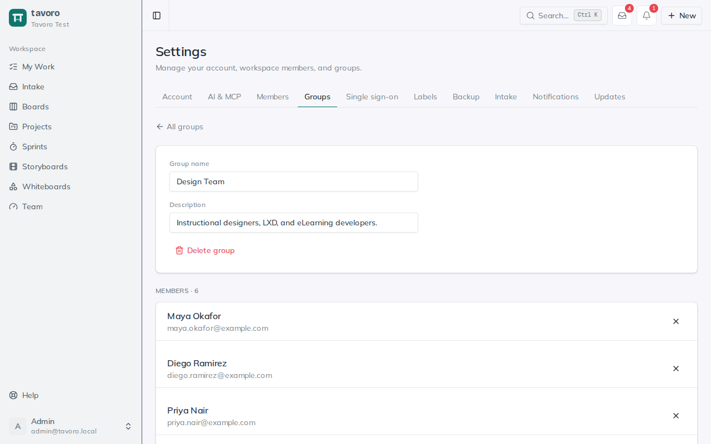

<!-- Generated from src/components/help by `npm run help:export`. Edit the app's help, not this file. -->

# Members, groups & access

> This is where admins run the workspace: add and remove people, hand out or revoke admin rights, reset passwords, and decide who can see which boards, projects, storyboards, and whiteboards. Everything here lives under **Settings** and is gated to administrators. To have your identity provider manage members instead, see [Single sign-on & provisioning](sso.md).

> **Note.** Admin-only. The **Members**, **Groups**, and **Single sign-on** settings appear only for workspace admins — members are redirected to their own **Account** page. Every workspace keeps at least one admin at all times.

## Managing members

*Settings → Members.*

Open **Settings → Members** to see everyone in the workspace, their email, and their role. Tavoro uses admin-provisioned accounts — there’s no open sign-up into an existing workspace — so you create each person’s login and share their first password out-of-band.

### Add a member

1. In the **Add a member** card, fill in **Name**, **Email**, and an **Initial password**. The password field shows plainly so you can copy it — it’s the credential you’ll hand off.
2. Choose a **Role** — **Member**, **Manager**, or **Admin** — then click **Add member**.
3. Share the email and initial password with the new person through a secure channel. They can change it themselves later from **Settings → Account**.

If the email already belongs to a user in another workspace, adding them here simply grants them access to this workspace rather than creating a second account.

### Reset a password

People lock themselves out. On any member’s row, click **Reset password**, type a new one into the **New password (min 8 chars)** field, and click **Set password**. The member can then sign in with it and set their own from Account. Admin resets don’t require the member’s current password — that’s the point of a reset.

### Change a role

Use the role dropdown on a member’s row to switch them between the three roles. There are exactly three, from most to least privileged:

**Admin** — Full control: manage members, groups, and workspace settings (intake, notifications, backup, updates), plus see and edit every board, project, storyboard, and whiteboard. Restricting a resource never locks out an admin.

**Manager** — An oversight role: the same “see everything” visibility as an admin across boards, projects, storyboards, and whiteboards — but *no* access to member, group, or workspace-settings management. Ideal for a team lead who needs the full picture without the admin keys.

**Member** — The default. Works within what they’ve been granted — open resources and any restricted ones shared with a group they belong to.

### Remove a member

Click the trash icon on a member’s row and confirm. This removes them from the workspace; if they don’t belong to any other workspace, their account is deleted outright.

> **Heads up.** Two guardrails you can’t override: you can’t remove yourself, and you can’t demote or remove the **last remaining admin** (suspended admins don’t count). Promote someone else to admin first if you need to step back.

## Members from your identity provider

If your workspace uses [single sign-on and provisioning](sso.md), your identity provider can add members for you, and the member list shows it:

- **SSO** marks a member linked to the identity provider. They sign in with their work account; you don’t need to give them a password.
- **Suspended** marks a member the identity provider deactivated. They can’t sign in and their API tokens stop working, but their work stays. **Restore access** lets them back in (the identity provider may suspend them again if it still has them deactivated).
- With roles from groups on, a member’s row says *Role comes from identity-provider groups*. You can still change it here, but the next update from the identity provider sets it back. Change the group instead.

## Organizing members into groups

Groups are named sets of people — “Leadership,” “Compliance Team,” “Contractors” — and they’re the unit you share resources with. Open **Settings → Groups** to manage them.

1. In **Create a group**, give it a **Name** and an optional **Description**, then click **Create group**.
2. Click into the group to open it. Under **Members**, use the **Add a member…** picker and **Add** to bring people in; the **×** on a row removes them.
3. Rename the group or edit its description inline at the top — changes save when you click away. **Delete group** removes the group and all of its resource-sharing (people and resources themselves are untouched).

## Group-based access control

*A group, with the resources shared with it.*

By default Tavoro is open: every board, project, storyboard, and whiteboard is visible to all members. Groups let you tighten that on a per-resource basis when something should only be seen by certain people.

You grant access from the group. Inside a group, the **Shared resources** section lists every board, storyboard, project, and whiteboard in the workspace, in four columns. Tick a checkbox to give *this* group access to that resource.

### How the default-open rule works

**No group ticked** — The resource has no group grants, so it stays open to all members — the default.

**Any group ticked** — The moment one group is granted access, the resource becomes restricted: only members of a group it’s shared with can see it.

**Admins** — Always retain access to everything, whether or not they’re in the group. Restricting a resource never locks out an admin.

So to lock down a sensitive project, add the right people to a group and tick that project in the group’s **Shared resources**. To reopen it to the whole workspace, un-tick it everywhere — with zero grants, it’s public to members again.

> **Tip.** Restriction is enforced, not merely hidden. A user without access can’t reach the resource through lists, the dashboard, *or* a direct link — the access check runs on every request, so pasted URLs don’t leak anything.

---

← [Single sign-on & provisioning](sso.md) · [All guides](README.md) · [Account & themes](account-themes.md) →
