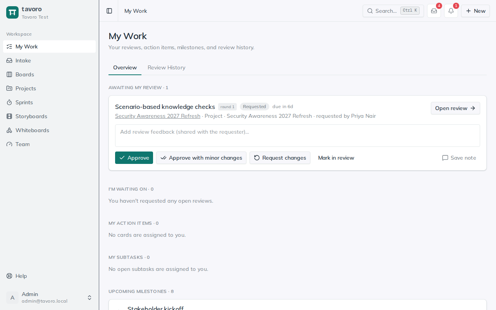

<!-- Generated from src/components/help by `npm run help:export`. Edit the app's help, not this file. -->

# My Work & reviews

> **My Work** is your personal hub — everything across the workspace that’s waiting on you, in one place. It answers two questions at a glance: what needs my attention, and what am I still waiting on from other people? It also keeps the history of reviews you’ve finished.

> **Note.** My Work never invents work. Everything here comes from reviews, cards, subtasks, and milestones you’re already attached to — so an empty page genuinely means you’re caught up.

## The Overview tab

*My Work: what needs you, and what you're waiting on.*

Open My Work from the sidebar (or the bell in the header) and you land on **Overview**. Each section shows a live count, with the most actionable work at the top:

**Awaiting my review** — Review rounds where you’re a reviewer and haven’t decided yet. You can open the review or decide right here (see below).

**I'm waiting on** — Open reviews *you* started: who’s still reviewing, and when it’s due.

**My intake requests** — Open intake requests assigned to you, with their status and needed-by date. Shown only when you have some.

**My action items** — Board cards assigned to you, with their board, column, and due date.

**My subtasks** — Open subtasks assigned to you, with the card they belong to.

**Upcoming milestones** — The next project milestones coming due, soonest first.

**My whiteboards** — Canvases you created, for quick jump-back-in access.

The second tab, **Review History**, holds the reviews that are already decided. More on that below.

## Reviewing something

When someone asks you to review a deliverable, it appears under **Awaiting my review** (and you’re emailed a link). Each entry names the deliverable, the project, who asked, the round number, and the due date.

1. Choose **Open review** to see exactly what was sent: the storyboard as it was when the round started, or the uploaded PDF or image. Comment there on specific text, screens, or pages.
2. Add an overall note in **Add review feedback (shared with the requester)…** if you like.
3. Decide: **Approve**, **Approve with minor changes**, or **Request changes**. You can decide on the review page or right here in My Work.

- **Mark in review** tells the requester you’ve started; the review stays in your queue.
- **Save note** stores your overall note without deciding.

A round passes when every reviewer approves (with or without minor changes). If anyone requests changes, the requester revises and starts the next round, which comes back to you.

## Asking for a review

Reviews start on a project deliverable, not in My Work: open the project and choose **Request a review** on the deliverable. The [Projects guide](projects.md) covers rounds, guest reviewers, and turning feedback into cards. Once it’s started, follow it under **I’m waiting on**.

## Where a review stands

**Requested** — Waiting for the reviewer to start.

**In review** — The reviewer has picked it up.

**Approved** — Signed off.

**Approved with minor changes** — Signed off, with small fixes to make. Counts as approval.

**Changes requested** — Sent back. The next round starts when the requester is ready.

**Requested** and **In review** are open and show on the Overview tab; the other three are decided and move to Review History.

## Review History & undo

**Review History** is a running record of decided reviews, both ones you reviewed and ones you requested: the deliverable, project, round, outcome, and the date, with the overall note underneath.

Decided too soon? Each row has **Undo approval** (for an approval) or **Reopen** (for changes requested). Either puts the review back to **In review** and back in the reviewer’s queue.

> **Heads up.** Undo reopens the same round rather than starting a new one, so the earlier decision is replaced. For a clean record of a second pass, start the next round on the deliverable instead.

---

← [Intake](intake.md) · [All guides](README.md) · [Notifications & email](notifications.md) →
