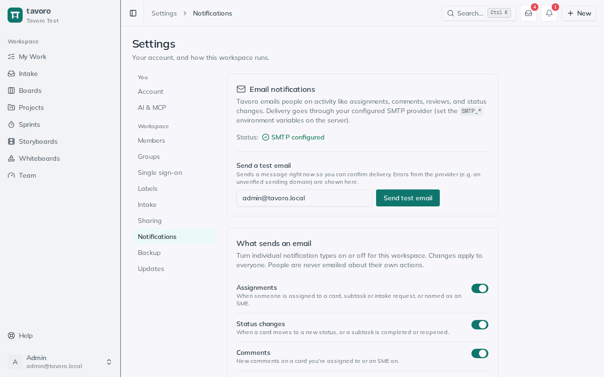

<!-- Generated from src/components/help by `npm run help:export`. Edit the app's help, not this file. -->

# Notifications & email

> Tavoro keeps people in the loop by email — a card assigned to you, a comment on work you’re an SME on, a review someone asked you to do. The guiding rule is simple: you’re never emailed about your own actions, so notifications stay signal, not noise.

## The one rule that shapes everything

Every notification is about something *someone else* did that affects *you*. If you move a card, complete your own subtask, or comment on a thread, Tavoro won’t email you about it — the person who took the action is skipped, and only the other people who care get the message. That keeps your inbox honest: an email means something changed that you didn’t already know about.

> **Note.** Notifications are opt-out, not opt-in. Every type is on unless an admin turns it off, so new kinds of activity reach people automatically without anyone having to go enable them first.

## What sends an email

There are eight categories of notification. Each one can be switched on or off for the whole workspace under **Settings → Notifications** (see below) — but by default, they all send.

**Assignments** — When someone is assigned to a card, subtask or intake request, or named as an SME.

**Status changes** — When a card moves to a new status, or a subtask is completed or reopened.

**Comments** — New comments on a card you’re assigned to or an SME on.

**Mentions** — When you’re @-mentioned in a comment or a card description.

**Reviews** — Review requests, and decisions on reviews you requested.

**Intake requests** — New stakeholder requests land in an admin’s inbox.

**Member accounts** — Welcome emails for new members and password-reset notices.

**Due-date reminders** — A nudge the day before something is due: cards (to their assignees), milestones (to admins), and reviews not yet decided (to the reviewer, guests included).

Notice how the audience is always the people connected to the work: a status change reaches the card’s assignees and SMEs, a comment reaches the same circle, a review decision goes back to whoever requested it. Tavoro figures out who to tell so you don’t have to cc anyone.

## Every email links straight back

No notification asks you to go hunting. Each one ends with a **View in Tavoro** button that deep-links to exactly the thing it’s about — the specific card, the review, the project, or the intake request — so you land on the right screen in one click.

> **Tip.** Emails to external stakeholders who can’t sign in (for example, an intake requester confirming their submission) skip the button, since there’s nothing for them to open. Everyone with a workspace account gets the link. When someone asks an intake requester a question, the email’s reply address is the asker’s own, so the answer reaches a person rather than a no-reply inbox.

## @-mentions in comments and descriptions

Sometimes you need a specific person, not just whoever’s already on the card. Mentions handle that. In a card’s comment thread or its rich-text description, type **@** and a picker appears — start typing a name or email to narrow it, then pick the member. When you post, that person gets a **Mentions** email with an excerpt and a link back to the card.

1. Open a card and click into the **Comments** box (or the **Description** field).
2. Type **@** followed by a few letters of the person’s name or email, then choose them from the list.
3. Finish your note and post it. The mentioned person is emailed with the surrounding text and a link straight to the card.

> **Who you can mention.** The picker only lists members who can actually access that board and card. You can’t mention someone into work they aren’t allowed to see — if a board is restricted to certain groups, only those people (and admins) show up.

Comments are rich text, so a mention sits inline alongside bold, italic, links, and lists. Mention as many people as a note calls for; each one gets their own email.

## Admin controls: Settings → Notifications

*Settings → Notifications.*

Admins tune the whole system from one screen. It’s admin-only — regular members don’t see it, and there are no per-person preferences to manage. Everything here applies to the entire workspace.

### Turning types on and off

Under **What sends an email**, each of the eight types has a toggle. Flip one off and Tavoro stops sending that category to *everyone*; flip it back on to resume. Changes save instantly — there’s no separate save button — so you can quiet a chatty category the moment it becomes a distraction.

> **Heads up.** These toggles are workspace-wide, not personal. Turning off **Status changes** silences status emails for the whole team, not just for you. Use them to set the overall tone of what Tavoro emails about.

### The SMTP status indicator

At the top of the panel, **Status** shows whether outbound email is working. When the server has an email provider configured, you’ll see **SMTP configured**. Until then it reads **Not configured** — and while it does, **nothing sends at all**, no matter how the toggles are set.

### Send a test email

Before you trust delivery, prove it. Enter a recipient and click **Send test email** to fire a message immediately. If the provider rejects it — an unverified sending domain, a bad credential — the exact error appears right there, so you can fix the setup instead of guessing. The button is disabled until SMTP is configured.

## How delivery is set up

Tavoro sends through your workspace’s own SMTP provider. Whoever runs your server sets the **SMTP_*** environment variables — host, credentials, and the address mail goes out from — and restarts the app. Once those are in place, the status flips to **SMTP configured** and notifications start flowing. There’s nothing to configure inside the app beyond the toggles; the connection itself lives in the server environment.

> **Nothing sends until SMTP is wired up.** If no SMTP host is set, Tavoro quietly sends nothing rather than failing loudly. If people say they’re not getting emails, an admin should check the status indicator first and send a test.

## Due-date reminders

Reminders are the one type that isn’t triggered by someone’s action — they run on a schedule. A background worker checks each day and, the day before a card or a project milestone is due, emails the people responsible so a deadline doesn’t sneak up. Like every other type, it respects the **Due-date reminders** toggle and only sends when SMTP is configured.

---

← [My Work & reviews](my-work.md) · [All guides](README.md) · [AI assistants (MCP)](ai-mcp.md) →
