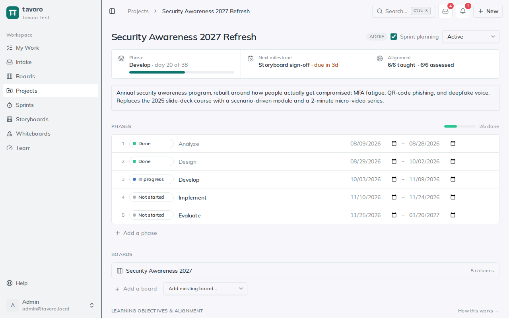
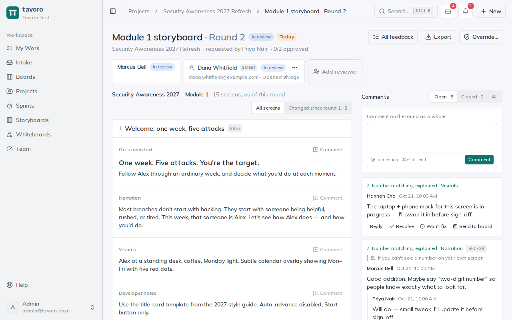
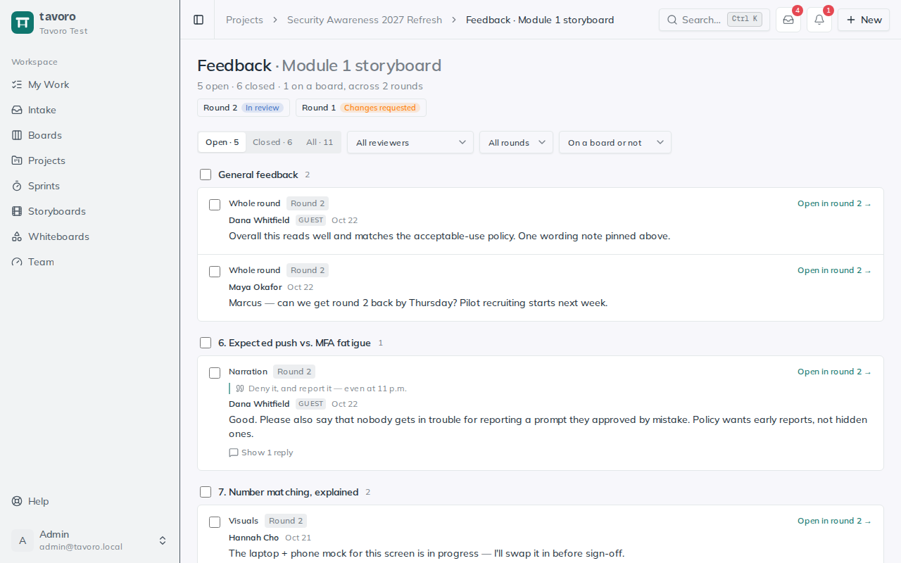

<!-- Generated from src/components/help by `npm run help:export`. Edit the app's help, not this file. -->

# Projects

> **Projects** are the instructional-design planning heart of Tavoro. A project holds the whole shape of a build: the methodology and its phases, the deliverables you owe, the SME and stakeholder reviews they go through, your milestones, and the time logged against it all — one place to answer “where is this, and what’s left?”

## Create a project and pick a methodology

Projects live under **Projects** in the sidebar. When you create one you choose a **methodology**, and Tavoro seeds the matching phases so you start with real structure instead of a blank page.

1. Choose **New project** on the **Projects** page (or **New → Project** in the header) and type a name in **Project name…**.
2. Pick **ADDIE**, **SAM**, or **Custom (start empty)** as the methodology, then choose **Create**. The project opens straight away.
3. Open the project to set its overall **Status** (**Active**, **On hold**, or **Completed**) and add a description.

Not sure which methodology fits? See [ADDIE vs. SAM](addie-sam.md) for what each is and when to reach for it. ADDIE seeds five phases, SAM seeds three, and Custom starts empty for you to build your own.

## Phases

*A project: phase progress, next milestone, alignment, then phases and boards.*

Phases are the stages your project moves through. Each one carries a status and optional start/end dates, and the project card in the grid shows a live *done / total* progress bar built from them.

- **Advance the status** — click a phase’s status badge to cycle it **Not started** → **In progress** → **Done**.
- **Set dates** — fill in **Start** and **End** to plan the timeline.
- **Reorder or edit** — use the up and down arrows to move a phase, click its name to rename it, and its delete button to remove it. Add more with **Add a phase**.

> **Note.** The seeded phases are a starting point, not a cage. Add, rename, reorder, or remove them freely so the pipeline matches how this particular project actually runs.

## Boards

A project’s **Boards** section lists the boards that carry its day-to-day work. Use **Add a board** to create one inside the project, or **Add existing board…** to bring in a standalone board. A project’s boards show the project’s phase, next milestone, and objective alignment above their columns.

## Deliverables

Deliverables are the things you’re actually producing — a storyboard, an assessment, a job aid. Add one with **+ Add a deliverable**, then set its type, status, and phase, and optionally connect it to the work happening elsewhere in the app.

### Type

Pick what the deliverable is: **Storyboard**, **Assessment**, **Job aid**, **Video**, **Document**, or **Other**. When the type is **Storyboard**, a **Create storyboard** button appears — one click spins up a linked storyboard (and **Open storyboard** jumps to it thereafter).

### Status

**Not started** — Queued — no work begun yet.

**In progress** — Actively being built.

**In review** — Out with a SME or stakeholder for feedback.

**Complete** — Done and approved.

### Link to a board card

Use the **Link a card…** dropdown to tie a deliverable to a specific board card, so the plan and the day-to-day execution point at the same work. Once linked, the card title shows as a chip you can follow straight to its board; the **×** unlinks it.

## Review rounds

*Round 2 of a storyboard review, with pinned comments beside the screens.*

Every deliverable has its own **review rounds**: the SME and stakeholder sign-off loop that’s the daily bottleneck for most ID teams. Each round freezes a copy of the linked storyboard, so reviewers comment on exactly what you sent, even if you keep editing.

1. On a deliverable, click **Request a review** and choose what’s being reviewed: the linked storyboard, or a **PDF or image** you upload (for example, a Storyline or Rise export). Pick reviewers from your workspace, and/or add **guests** by name and email for SMEs who don’t have an account. Set a due date and click **Start round 1**. Everyone is emailed a link.
2. Reviewers select text in any storyboard field and comment on it. On a PDF or image, they click to drop a numbered pin or drag to mark an area. On a PDF, they can also select text and choose**Comment on selection** to quote it. They can also leave general feedback. Then they choose **Approve**, **Approve with minor changes**, or **Request changes**. The round passes only when **every** reviewer approves (with or without minor changes).
3. Reply to comments, and mark them **Resolved** or **Won’t fix** with a note the reviewer sees. Then start the next round: it goes back to the same people, and the review page highlights what changed since the last one.

> **Tip.** Reviewing a file? PDFs and PNG, JPEG, WebP or GIF images up to 95 MB work. For an e-learning build, publish it to PDF (Storyline: **Publish → Print**) and upload that. Tavoro shows files; it never runs them. For the next round, upload the new version, or reuse the same file.

### Guest reviewers

A guest gets a personal link that opens just that one round: no account, no sidebar, nothing else in your workspace. Guests can’t @-mention anyone, and they never see member email addresses. A link lasts until two weeks after the due date (90 days at most). After a guest decides, their page is read-only unless they reopen their decision.

- On the round page, a guest’s **⋯** menu lets you copy their link, re-send the invite, reset the link (the old one stops working), or turn it off.
- Starting a new round sends each guest a new link. Links from earlier rounds become read-only.
- Guests and members with an undecided review get a reminder the day before it’s due.

> **Tip.** Admins and managers can **Override** a round to pass it without every approval, for example when an SME has gone silent. A reason is required, and it’s shown on the round.

### Turn feedback into work

*All feedback: every comment from every round, ready to resolve or send to a board.*

Review comments become board cards, so fixing them happens where the rest of your work does.

- On any open comment, click **Send to board**. Pick a board and column, and Tavoro makes a card that quotes the comment and links back to it. The comment shows the card’s key.
- **All feedback** (on the deliverable, or at the top of a round) lists every comment from every round, grouped by screen or page. Filter by reviewer, round, or whether it’s on a board yet, then select several to resolve them together or send them to a board: one card each, or one card with a subtask per comment.
- A card made from feedback lists its comments under **Review feedback**. When the card is done (or a comment’s subtask is ticked), it offers to resolve the comments, so the reviewer sees the outcome.

### Export

**Export** on a round gives you a **Word document** or a **PDF** (a print view: choose **Save as PDF** in the print dialog). It lists the reviewers and their decisions, then every screen with each comment beside the field it’s about, or each page of a reviewed file with its comments. Storyboards have the same **Export** menu, without comments.

## Milestones and time tracking

**Milestones** are the dated checkpoints that matter — a kickoff, a pilot, a go-live. Add one with **Add a milestone**, give it a due date, and check it off when it’s hit; overdue, uncompleted milestones show their date in red. Upcoming milestones also surface on your home dashboard and in My Work.

**Time tracking** records effort against the project. Click **+ Log time**, enter the date and hours, optionally attribute it to a deliverable and add a note, then click **Log**. The section header keeps a running total of hours logged across the whole project.

## Sprint planning

A project can opt into **sprints** — time-boxed iterations the team runs on a shared board. Turn on **Sprint planning** on the project to make its board cards assignable to a sprint; from there they show up on the team sprint board grouped by status. See the [Sprints](sprints.md) guide for how sprints work end to end.

> **Note.** Projects are visible to all workspace members by default. An admin can restrict a project to specific groups in **Settings → Groups**; once restricted, only those groups (plus admins and managers) can see it in the list, on the dashboard, or via a direct link.

---

← [Boards (Kanban)](boards.md) · [All guides](README.md) · [Sprints](sprints.md) →
