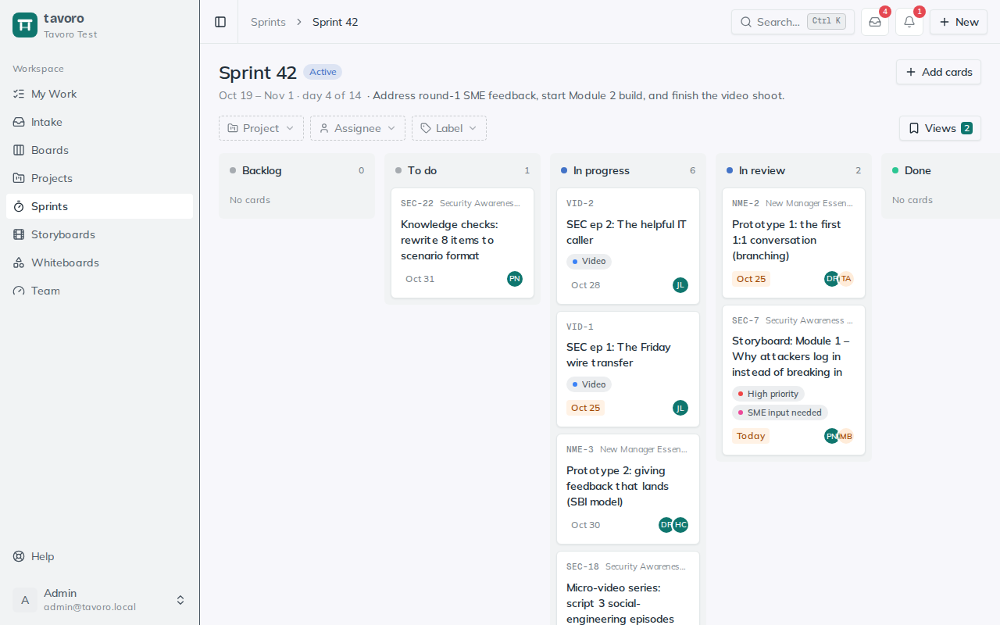

<!-- Generated from src/components/help by `npm run help:export`. Edit the app's help, not this file. -->

# Sprints

> A **sprint** is a time-boxed iteration for your whole team — a named window with a goal and start and end dates that pulls cards from across your boards into one focused push. Where boards run the pipeline and projects hold the plan, sprints are the cadence: “here’s what we’re finishing together in the next two weeks.”

## Create a sprint

Sprints live under **Sprints** in the sidebar. Every sprint belongs to your workspace, so a single sprint can gather cards from any board or project the team is working across.

1. On the **Sprints** page, type a name into **New sprint name…**, optionally add a one-line goal in **Goal (optional)**, and click **Create sprint**. The new sprint appears at the top of the list.
2. Set its window with the two date fields on the sprint row — a start date, the **→** arrow, and an end date. Both are optional, but they’re what makes the sprint a real time box.
3. Rename a sprint by clicking its title, and edit its goal in place. The count beside the name shows how many cards are currently in the sprint.
4. Move the sprint through its life with the status dropdown — **Planned** while you’re still gathering cards, **Active** once work is underway, and **Completed** when the window closes.

> **Sprint status.** A sprint’s status is its own lifecycle — it’s separate from the status of the cards inside it. Marking a sprint **Completed** is a record that the iteration is over; it doesn’t move or close the cards on it.

**Planned** — The default for a new sprint. Use it while you’re still deciding scope and pulling cards in.

**Active** — The sprint is running. This is the signal that the team is heads-down on these cards for the current window.

**Completed** — The window has closed. Cards that didn’t finish keep living on their home boards — you can move them to the next sprint.

## The sprint board

*Sprint 42's board: cards from across projects, grouped by status.*

Click **Open board** on any sprint to see its cards laid out as a Kanban view. Instead of the columns a single board uses, the sprint board groups every card by your workspace’s statuses — by default **Backlog**, **To do**, **In progress**, **In review**, and **Done** — so a mix of cards from different boards reads as one shared picture of progress.

Each card shows its key, title, home project, labels, due date, and assignees. Click a card to open the same full card drawer you use on a board — description, subtasks, comments, attachments, and all. Filter the view with the **Project**, **Assignee**, and **Label** pickers at the top; while a filter is on, the bar shows *N of M cards* and **Clear** resets it. Filtering by label works across projects because labels belong to the workspace, not to a single board. Keep a combination you use often by opening **Views** → **Save current filters…**; sprint views are personal to you and available on every sprint board.

### Moving cards changes their status

Drag a card from one status column to another and it updates that card’s canonical status everywhere — this is the same status the card carries on its home board, not a sprint-only setting. Because it’s a real status change, it sends the usual status-change notification to people watching the card.

> **Notifications.** The email that goes out when a card’s status changes is covered in the Notifications article — sprint moves are just one of the places that trigger it.

## Getting cards onto a sprint

There are two ways to add a card to a sprint, and both do the same thing under the hood.

- **From the sprint board** — click **Add cards**, search by title or card key, and click **Add** next to each one. The picker lists cards that aren’t already in a sprint.
- **From a card** — open any card and set its **Sprint** field to the sprint (or back to **No sprint** to remove it). This is handy when you’re already working on a board and want to tag a card as you go.

Removing a card from a sprint never deletes it — the card stays on its home board. The same is true if you delete the sprint itself: its cards stay put and simply lose the sprint tag.

## Turning on sprint planning

The **Sprint** field only shows on a card when its project has opted in. Open a project and toggle **Sprint planning** on to surface that field for the project’s cards, so the team can assign them to sprints without leaving the board.

> **Tip.** You can always add cards from the sprint board’s **Add cards** picker regardless of the toggle — the per-project switch is about whether the **Sprint** field appears directly on those cards.

### How sprints fit boards and projects

Think of the three as layers that point at the same work. **Boards** are the pipeline — the day-to-day columns and cards. **Projects** are the plan — phases, reviews, and deliverables over time. **Sprints** are the team’s cadence, reaching across boards and projects to pull a slice of cards into one time-boxed iteration. A card can live on a board, belong to a project, and ride in a sprint all at once, and updating its status in any of those views updates it in all of them.

---

← [Projects](projects.md) · [All guides](README.md) · [Storyboards](storyboards.md) →
