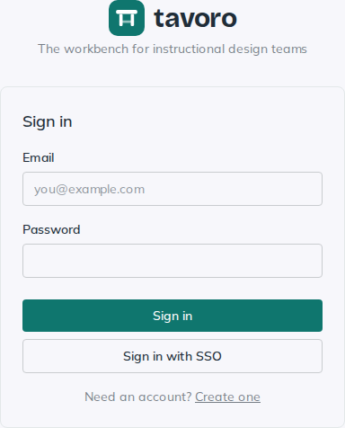
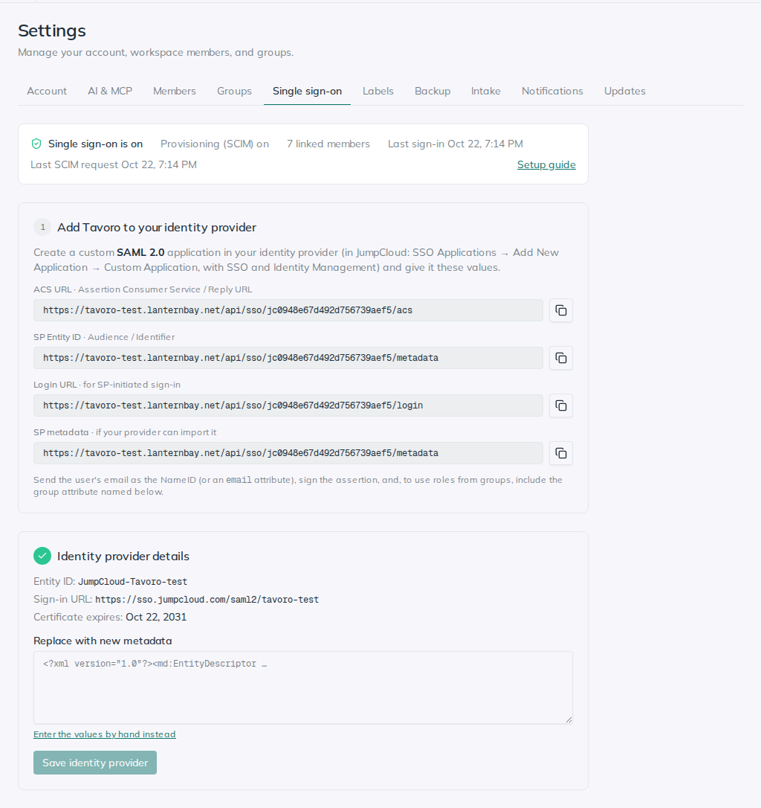

<!-- Generated from src/components/help by `npm run help:export`. Edit the app's help, not this file. -->

# Single sign-on & provisioning

> Connect Tavoro to your company’s identity provider (IdP) so people sign in with their work account, get added and removed automatically, and receive their Tavoro role from the groups they’re in. Tavoro speaks the two open standards most identity providers support: **SAML 2.0** for sign-in and **SCIM 2.0** for provisioning.

> **Note.** Admin-only. Everything here lives in **Settings → Single sign-on**. Each workspace has its own connection, so two workspaces can use different identity providers.

## What each part does

*The sign-in page. “Sign in with SSO” uses the email typed above it.*

**Single sign-on** — People choose **Sign in with SSO** on the sign-in page (Tavoro sends them to the identity provider for their email’s domain), or click Tavoro in their identity provider’s app portal. Either way the provider vouches for them with a signed SAML response, and they land in the workspace.

**Create on first sign-in** — Optional. Anyone the identity provider lets into the app gets a Tavoro account the first time they sign in. With it off, only people already in the workspace (added by an admin or by provisioning) can sign in.

**Provisioning (SCIM)** — Optional. The identity provider creates members ahead of their first sign-in, keeps their name and email current, deactivates them when they leave, and sends their groups. A deactivated member is **suspended**: they can’t sign in and their API tokens stop working, but everything they made stays, attributed to them.

**Roles from groups** — Optional. Map identity-provider groups to Tavoro roles (**Admin**, **Manager**, **Member**). A member gets the highest role any of their groups maps to, and the default role otherwise.

**Require SSO** — Optional. Members can no longer sign in with a password. Admins still can, so there’s always a way in if the identity provider is down.

## Set it up (any identity provider)

*Settings → Single sign-on: steps 1 and 2.*

Keep two tabs open: Tavoro’s **Settings → Single sign-on** and your identity provider’s admin console. The settings page walks through the same five steps.

1. **Create the app in your identity provider.** Add a custom **SAML 2.0** application and paste in the values from step 1 of Tavoro’s settings page (see the table below for what your provider calls each one). Send the user’s email address as the NameID, or in an attribute named `email`. Optionally also send `firstname` and `lastname` attributes, which Tavoro uses for the member’s name.
2. **Give Tavoro the identity provider’s details.** Download the app’s SAML metadata (XML) from your provider and paste it into step 2. If your provider doesn’t offer metadata, choose **Enter the values by hand instead** and paste its entity ID, sign-in URL and signing certificate.
3. **Turn on sign-in.** In step 3, tick **Turn on single sign-on**, list your **Email domains**, and save. Use **Test sign-in in a new tab** with an account your provider has assigned to the app.
4. **Optional: turn on provisioning.** In step 4, choose **Create token** and copy the token (it’s shown only once). In your provider, enable SCIM 2.0 provisioning for the app with Tavoro’s **SCIM base URL** and the token.
5. **Optional: roles from groups.** In step 5, tick **Manage roles from groups**, map group names to roles, pick the role for everyone else, and save. If you don’t use provisioning, also have your provider send a groups attribute in the SAML response, named as in step 3’s **Group attribute name** (default `memberOf`).

### Values to give your identity provider

Identity providers name these fields differently. The values themselves are on Tavoro’s settings page, with copy buttons.

| Tavoro | Also called | What it is |
| --- | --- | --- |
| **ACS URL** | Assertion Consumer Service URL, Reply URL, Single sign-on URL | Where the provider sends the signed response. |
| **SP Entity ID** | Audience, Audience URI, Identifier, SP Issuer | Tavoro's name for itself. Must match exactly. |
| **Login URL** | Sign-on URL, Start URL | Starts a sign-in from Tavoro's side (SP-initiated). |
| **SP metadata** | Service provider metadata | All of the above in one XML file, for providers that can import it. |
| **SCIM base URL** | Base URL, Tenant URL, SCIM connector base URL | Where provisioning requests go. Enter it without a trailing slash. |
| **SCIM token** | Token Key, Secret Token, API token, Bearer token | Proves the requests come from your provider. |

From your identity provider, Tavoro needs:

- **Entity ID** (Issuer), **sign-in URL** (SSO URL) and the **signing certificate**, all usually in its SAML metadata.
- **A signed response or a signed assertion.** Either is fine; Tavoro rejects responses with neither.
- **The user’s email** as the NameID or in an `email` attribute.

## Provider guides

Step-by-step notes for providers Tavoro has been tested with. Other SAML 2.0 and SCIM 2.0 providers should work with the steps above.

### JumpCloud

1. In the JumpCloud Admin Portal, open **SSO Applications**, choose **Add New Application**, search for and pick **Custom Application**, and select **Manage Single Sign-On (SSO)** with **SAML 2.0**. Tick **Identity Management** too if you want provisioning; JumpCloud attaches SCIM only to SAML apps.
2. On the **SSO** tab: set **IdP Entity ID** to any unique name (for example `JumpCloud-Tavoro`), paste Tavoro’s **SP Entity ID** and **ACS URL**, set **SAMLSubject NameID** to **email**, and paste Tavoro’s **Login URL**. JumpCloud signs the response by default, which Tavoro accepts.
3. Optionally, under **User Attributes**, send JumpCloud’s `firstname` and `lastname` as `firstname` and `lastname` so members get their names. For roles from groups, tick **Include Group Attribute** and set **Groups Attribute Name** to `memberOf` (or whatever you entered in Tavoro). JumpCloud sends the groups that give the user access to the app.
4. Save, then use **Export Metadata** and paste the XML into step 2 in Tavoro. Bind the user groups that should have Tavoro on the app’s **User Groups** tab.
5. For provisioning, open the **Identity Management** tab: **API Type** **SCIM API**, **SCIM Version** **SCIM 2.0**, **Base URL** = Tavoro’s SCIM base URL, **Token Key** = Tavoro’s SCIM token. For **Test User Email** use an address that isn’t in Tavoro yet: JumpCloud creates and then deletes it as a test.
6. Choose **Test Connection**, turn on group management (**Enable management of User Groups and Group Membership**) to send groups, then **Activate** and **Save**. Provisioning requests appear in Tavoro under **Recent provisioning requests**.

> **Tip.** In JumpCloud, access is granted through user groups: people get Tavoro by being in a group bound to the app. Removing someone from every bound group deactivates them in Tavoro.

**The app tile says “JumpCloud could not connect to your application”** — JumpCloud couldn’t sign the response, which its documentation puts down to a damaged key pair. On the app, choose **Actions → Regenerate Certificate** and save, then download the new certificate (or export the metadata again) and paste it into step 2 in Tavoro.

**The tile opens a “Not Found” page** — The app’s IdP URL isn’t a full address. On the **SSO** tab it should read `https://sso.jumpcloud.com/saml2/<your-name>`. Tavoro refuses metadata whose sign-in URL is incomplete, so export it again after fixing this.

**The test user stays in Tavoro** — JumpCloud’s activation test creates and then deletes its **Test User Email**. Tavoro keeps a deleted user as **Suspended** rather than erasing them; remove them in **Settings → Members**, or add them to a bound group to give them access for real.

### Adding another provider

Okta, Microsoft Entra ID and others follow the same pattern: a custom SAML 2.0 app with Tavoro’s values, then SCIM 2.0 provisioning to the SCIM base URL with the token. Check that your provider offers SCIM for *custom* apps; some only provision to apps in their own catalog. Tavoro’s provisioning accepts the request styles the major providers use, and **Recent provisioning requests** shows exactly what yours sends.

## How roles from groups work

- Group names match without regard to case. A member in several mapped groups gets the highest role: Admin, then Manager, then Member.
- Roles update when provisioning changes a group, and at each sign-in. Changing the mappings re-applies them to everyone linked to the identity provider at once.
- With provisioning on, it decides group membership. With it off, the group attribute in each sign-in does; a sign-in without the attribute means “no groups”, so a removed admin drops to the default role.
- A role changed by hand in **Settings → Members** lasts until the next update from the identity provider; the member list says when a role comes from groups.
- Tavoro never demotes or suspends the workspace’s last active admin; that request is refused.

## Day to day

**Someone leaves** — Deactivate or remove them in the identity provider. Tavoro suspends their membership: they’re signed out of the workspace, their API tokens and connected apps stop working, and their cards, comments and reviews stay as they were. In **Settings → Members** they show as **Suspended**.

**Someone comes back** — Reactivate them in the identity provider, or choose **Restore access** on their row in Tavoro (the provider may suspend them again if it still has them deactivated).

**The certificate is renewed** — Paste the provider’s new metadata into step 2. Tavoro shows when the current certificate expires and warns 30 days ahead. During a rollover you can paste both certificates; either one is accepted.

**The identity provider is down** — Admins can still sign in with their password, even when SSO is required. An admin can set a password for anyone from **Settings → Members**.

## Troubleshooting

When a sign-in through the identity provider fails, the sign-in page says why:

| Message | What to check |
| --- | --- |
| …couldn't be verified | The certificate, entity ID or SP Entity ID don't match, the response wasn't signed, or the clocks are more than a minute apart. Re-paste the provider's metadata and compare the SP Entity ID character for character. |
| …didn't send an email address | Set the NameID to the user's email, or add an email attribute. |
| …don't have a Tavoro account in this workspace yet | Create on first sign-in is off. Turn it on, add the person, or provision them. |
| …access to this workspace has been turned off | The member is suspended. Reactivate them in the provider, or choose Restore access in Tavoro. |
| …isn't available for that workspace | Single sign-on is switched off, or the identity provider's details are missing. |

- **“Single sign-on isn’t set up for that email’s domain”**: add the domain under **Email domains**. A domain can belong to one workspace’s connection only.
- **Provisioning fails**: open **Recent provisioning requests**. A 401 means the token is wrong (make a new one and update the provider); other errors say which field or operation Tavoro couldn’t accept. Check the base URL has no trailing slash.
- **Roles don’t change**: the group name in Tavoro must match the provider’s exactly (apart from case). The **Groups Tavoro has received** list shows the names that have arrived.

---

← [AI assistants (MCP)](ai-mcp.md) · [All guides](README.md) · [Members, groups & access](members-access.md) →
