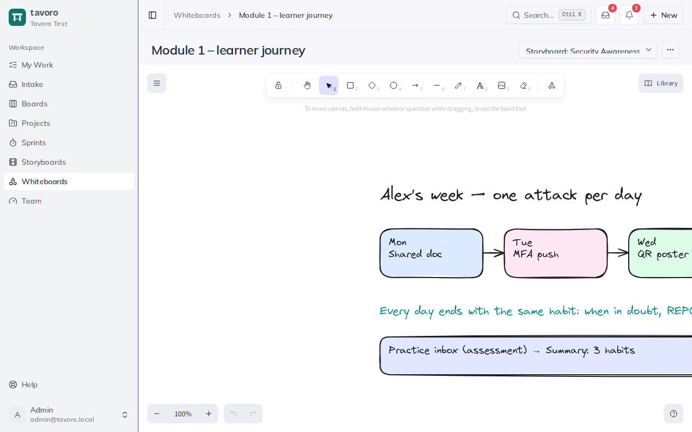

<!-- Generated from src/components/help by `npm run help:export`. Edit the app's help, not this file. -->

# Whiteboards

> **Whiteboards** are freeform Excalidraw canvases for the messy, visual part of design work — sketching a course flow, wireframing a screen, or mapping out ideas before they harden into storyboards and cards. They autosave as you draw, and they attach to your work in three different ways.

## Drawing on a whiteboard

*A whiteboard linked to a storyboard.*

A whiteboard is a full Excalidraw canvas: shapes, arrows, text, freehand drawing, sticky frames, and images — the familiar toolset for quick diagrams and wireframes. Open one from the **Whiteboards** page (or from wherever it’s linked) and start drawing.

- **Rename** — edit the title in the header; it saves when you click away.
- **Autosave** — your scene saves automatically a moment after you stop drawing. There’s no save button; just close the tab when you’re done.
- **Delete** — open the **⋯** (**Whiteboard settings**) menu in the header and choose **Delete whiteboard…** (you’ll be asked to confirm).

## Working on one together

Several people can have the same whiteboard open. Each save merges shape by shape instead of replacing the whole drawing, and an open whiteboard picks up everyone else’s changes every few seconds, without reloading. If two people change the *same* shape at once, the later change wins; everything else is kept.

> **Note.** Saving waits until your edits settle, so give it a second after your final stroke before closing the tab. Scrolling and zooming don’t count as changes.

## Drawing with an AI assistant

An assistant connected to Tavoro (see **AI assistants (MCP)**) can read a whiteboard and draw on it. Ask it to sketch a course map, a learner journey or a branching scenario, and it adds labelled boxes, sticky notes, frames and arrows, laid out for you. It can also move, relabel, recolour or delete what’s there, or turn a whiteboard into a summary. Its changes appear on an open whiteboard within a few seconds and never overwrite what you’re drawing.

An assistant reads a whiteboard as its text and what connects to what. It doesn’t see freehand drawings or the inside of images.

## The three ways whiteboards attach

A whiteboard is always its own thing, but where you create it determines what it’s tied to — which shapes how you’ll find it later:

**Standalone** — Created from the **Whiteboards** page. Belongs to the workspace on its own, unattached to any storyboard or card — perfect for scratch thinking and brainstorms.

**Linked to a storyboard** — Created from a storyboard’s **Whiteboards** section (or linked to one afterward). Keeps a course’s visual sketches next to its screens.

**Created from a board card** — Created via **+ New whiteboard** in a card’s drawer. Stays tied to that card, so the sketch and the work item live together.

### Create a standalone whiteboard

1. Choose **New whiteboard** on the **Whiteboards** page (or **New → Whiteboard**in the header) and type a name in **Whiteboard title…**.
2. Choose **Create**. The canvas opens straight away.

### Change what a whiteboard is linked to

On any whiteboard, the header has a linked-storyboard dropdown. Pick a storyboard to link it, or choose **No linked storyboard** to detach it. That makes it easy to promote a standalone sketch into a specific course’s working set once you know where it belongs.

> **Tip.** Working inside a card or a storyboard? Create the whiteboard from there rather than the **Whiteboards** page — it’ll come pre-linked, and you won’t have to hunt for it or wire up the connection by hand later.

## Finding your whiteboards

The **Whiteboards** page lists every whiteboard in the workspace, most recently updated first. Each card notes whether it’s linked to a storyboard or standing on its own. Ones tied to a storyboard or card are also reachable directly from that storyboard’s **Whiteboards** section or the card’s drawer.

> **Access.** Whiteboards are visible to all workspace members by default. An admin can restrict one to specific groups in **Settings → Groups**; once restricted, only those groups (plus admins and managers) can open it, whether from the list or a direct link.

---

← [Storyboards](storyboards.md) · [All guides](README.md) · [Intake](intake.md) →
